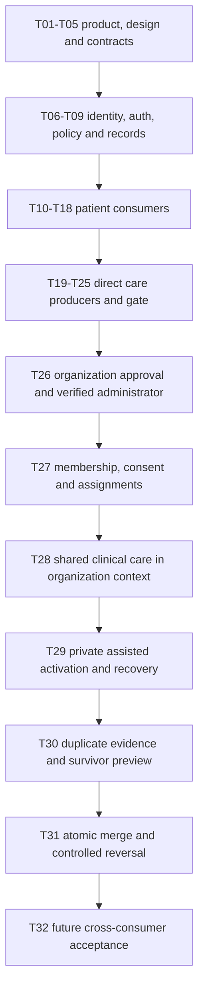
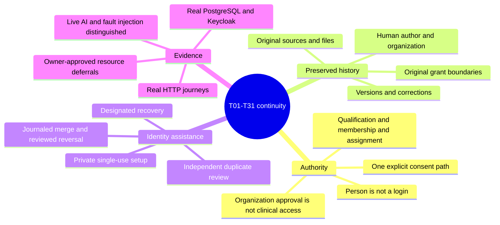

# T26-T31 organization and identity phase

## Resume Checkpoint - 2026-10-13

Final outcome: local T26-T31 implementation and scoped T01-T31 regression verification complete, with explicitly owner-approved resource deferrals. Full suite 74/74; affected guard/access/organization/merge follow-up 18/18; final typecheck/lint/build and direct/organization HTTP journeys passed. Earlier failures and repairs below are historical evidence, not current failing gates. No visual tests, hosted changes, production migration or deployment. Work stops at T31.

Owner reaffirmed the boundary: finish/cross-check T01-T31 only; do not start T32-T36 or spend resources on irrelevant visual tests. WORKFLOW and current changes were retraced. T26-T31 services and screens now exist, including merge/reversal and post-reversal recovery. The earlier table below is updated to implementation state, not a claim that inherited external acceptance gates passed.

New completed evidence: production build, typecheck, lint and client-bundle scan passed on 2026-10-12. Real HTTP scripts verify-direct-http.mts and verify-organization-http.mts passed. Organization HTTP exercises actual signup/setup/login, professional and organizational approval, targeted staff invitation, no-contact registration, initial care/finalization, activation, patient consent/assignment, administrator denial, designated recovery/old-session denial, duplicate approval, merge replay/reversal and organization revocation. No browser or visual testing was performed.

Post-reversal recovery was hardened: ordinary activation of a retired identity is denied, reviewed recovery creates a fresh provider enrollment and old accounts remain retired. Real Keycloak auth/assistance/merge tests passed 9/9 before the last extension. A synthetic test omission (in-person consent evidence) in the added organization-merge test was corrected. The next attempt reached provider integration but Keycloak had stopped during interruption; restarted the same isolated provider. No production configuration or hosted data was touched.

Full regression from the earlier checkpoint was 70/73; live Gemini requests failed and one dependent practitioner assertion cascaded. Extraction retry passed. Practitioner revocation assertion now compares before/after counts independently of a prior live-model success; the live model test is retained, with a timeout exceeding the gateway's own bounded timeout. The interrupted run is not claimed passed; a new complete final run passed 74/74.

Local saved app database now includes all five new migrations; fresh isolated PostgreSQL tests also apply them. Do not rewrite applied migrations to repair schema; use a follow-up migration. T32+ remains unstarted. Patient contact-verification/delivery integration and named human launch reviews remain inherited open gates.

## Scope and baseline

Owner authorization: 2026-10-12, T26-T31 plus T01-T31 continuity and regression checks. Visual testing only when essential. Preserve the inspected design and existing edits. No deployment or production cutover is implied.

Implementation root: `C:/Users/maseglo.com/.codex/worktrees/mhistree-rebuild/mhistree`, branch `codex/rebuild`, baseline commit `0e8081b`. Original app remains at `C:/Users/maseglo.com/Documents/FS-projects/Mhistree/mhistree`. Existing changes on arrival: practitioner workspace route, clinical work service, patient/workspace views, direct HTTP verification script, and practitioner audit migration. These are retained.

Read requirements: AGENTS, WORKFLOW, full playbook pages 33-39 and Appendices A-D, identity-access contract, design guide/catalog, task packets, access/identity/practitioner owners and their tests. Practitioner and clinical-care READMEs and practitioner phase evidence were absent on arrival; workflow was behind the committed implementation.

## Dependency and decision map

Keep administration, qualification, operational privileges, consent and assignment separate. Extend the existing private schema and shared service owners. Record original provenance and retain grants as independent paths. Merge must use canonical mappings and immutable origin evidence; never rewrite original clinical evidence or union grants. Reversal requires explicit handling of later contributions and consent. Recovery uses existing provider-backed restricted setup; staff never choose patient passwords.

## Ordered work and gates

| Task | Status | Required output and checks | Consumer |
| --- | --- | --- | --- |
| T25 prerequisite | verified locally | Direct HTTP journey passed; recovered documentation reconciled; historical provider failures resolved | T26 |
| T26 | verified locally; targeted tests 2/2 | Registration and restricted review screens/services, verified initial administrator, administration-only grants, suspension and durable notifications | T27 |
| T27 | verified locally; targeted tests 2/2 | Staff invitation acceptance, explicit privileges, scoped consent, assignments and selected context; removal preserves direct access | T28-T29 |
| T28 | verified locally; targeted tests 2/2 | No-contact registration, initial care via shared finalization, organization result recipient with human attribution; policy rejects other-origin history and merged initial-care path | T29-T31 |
| T29 | verified locally; real provider test 1/1 | Private setup/replacement/recovery UI, independent recovery designation and restricted support queue; no-contact session retirement tested | T30 |
| T30 | verified locally; targeted tests 2/2 and HTTP passed | Patient/staff flags, restricted reviewer screen, survivor cases and uncertain ownership denial | T31 |
| T31 | verified locally; targeted tests 3/3 and HTTP passed | Locked idempotent merge, immutable journal, retired credentials, retained original files/chat and grants, reviewed reversal with later records | T32 (not authorized) |

## Verification log

- Initial `pnpm typecheck`: passed.
- Initial `pnpm test`: 54/62 passed, eight auth/account failures traced to stopped Keycloak. Restarted isolated Keycloak and saved local synthetic PostgreSQL via existing scripts; no hosted schema contacted. `pnpm exec vitest run tests/integration/auth.test.ts tests/integration/patient-account.test.ts`: 10/10 passed.
- First `pnpm exec tsx scripts/verify-direct-http.mts`: approval, consent, booking, text, private-note isolation, final entry and result passed; final revocation request failed validation because the existing script used `connectionId` instead of the route's `id`. Corrected the script; complete rerun passed.
- T26 organization approval: 2/2. T27 assignments: 2/2. Initial T28 test exposed an uninitialized PL/pgSQL connection record in the original `can_access` initial-care branch; fixed with a typed nullable row. Initial-care plus all 11 prior access/kernel tests: 12/12. Existing clinical-entry tests: 2/2. Organization care extended to result publication: 2/2. Assignment/care/direct-result regression before extension: 5/5.
- T29 real Keycloak no-contact activation/replacement/recovery and restricted escalation: 1/1. T30 duplicate privacy/review and survivor selection: 2/2.
- Repeated typechecks passed through T29; resume check pending. Full final lint/build/test/HTTP/client scan remain pending.
- No visual tests performed.

Final commands on 2026-10-13: `pnpm test -- --reporter=json --outputFile=.local/t01-t31-final.json` passed 74/74; affected `vitest run` for organization-care, organization-assignments, merge and access-records passed 18/18 after the final guard. `pnpm typecheck`, `pnpm lint`, `pnpm build`, `pnpm check:client`, `git diff --check`, both HTTP journey scripts and saved-local migration preparation passed. Original PDF SHA-256 matches AGENTS. `git diff --numstat -- legacy` is empty. Raw JSON results remain ignored under .local; this file retains the durable nonsecret outcome.

## Next action

Stop at T31. Practitioner, clinical-care, organizations and identity READMEs, feature map and identity/access contract now describe actual owners and decisions. Future resource-dependent work needs the inputs in the follow-up guide and new authorization; do not start T32+. Missing integrations remain deferred/unverified, not mocked or silently marked complete.

## Current code map

- `features/organizations/server.ts`: registration, own organizations, restricted reviewer, administrator/status guard; `membership.ts`: invitation/acceptance/update and staff authority projection; `assignments.ts`: consent, category-bounded assignment and assigned-patient list.
- `features/organizations/care.ts`: shared identity registration/lookup, explicit initial-care basis, authorized workspace; `view.tsx`, `staff-view.tsx`, `registration-view.tsx`: corresponding screens. `app/organizations` composes guarded pages; `app/api/organizations` validates transport and invokes owners.
- `features/identity/assistance.ts`: designated recovery, identity-support evidence/review, wrapper over existing auth issuance; `assistance-view.tsx`: restricted staff/reviewer screens. `duplicates.ts`: limited flags, review preview, survivor decision and independent approval. `app/api/review/identity` and `app/review/identity` expose support tools.
- Shared owners extended: `features/clinical-care/work.ts` and `entries.ts` accept initial-care drafts/finalization; `features/practitioner/workspace-view.tsx` composes explicit organization context; `features/ai-chat/practitioner.ts` reuses retrieval under selected organization authority; `features/auth/server.ts` restricts organizational assistance to an original organizational identity or active connection.
- New migrations: `20261012081015_organization_approval.sql`, `20261012081249_organization_membership_assignments.sql`, `20261012081711_organization_initial_care.sql`, `20261012082233_identity_assistance_review.sql`, `20261012082625_duplicate_review_merge_journal.sql`. Last contains immutable review/journal tables, canonical patient-read resolver and original-scope provider policies. `features/identity/merge.ts` executes/reverses mappings; `features/auth/reconciliation.ts` retries provider retirement.
- Tests: `organization-approval.test.ts`, `organization-assignments.test.ts`, `organization-care.test.ts`, `identity-assistance.test.ts`, `duplicates.test.ts`, `merge.test.ts` under `tests/integration`.

## T01-T31 Continuity Review

| Earlier tasks | New dependency check | Evidence or unresolved gate |
| --- | --- | --- |
| T01-T05 | Same product canon, retained PDF, isolated rebuild, no redesign | Governing SHA remains recorded; no original app or legacy edits |
| T06-T09 | Same identity/auth/access/atomic kernel | Prior tests retained, real Keycloak, new migrations on fresh PG and saved local app |
| T10-T18 | Activation claims existing person; patient sees finalized organizational care and controls consent | Real organization HTTP and patient regression; optional contact delivery remains unconfigured |
| T19-T25 | Same qualification, clinical work/results and explicit direct context | Direct HTTP passed; organization workflows compose the same owners; live AI gate reported separately |
| T26-T29 | Approval -> membership -> consent/assignment -> care -> assistance | Real service and HTTP checks, no admin clinical bypass or staff-selected password |
| T30-T31 | Limited duplicate report -> evidence/survivor -> merge -> reviewed reversal | Concurrency, rollback, later-work conflict, old sessions, alias resolution and original grant tests |

## Decision and Failure Map

1. Preserve original person/source/context IDs and derive patient history through canonical mapping. This avoids destructive reparenting and leaves provider grants independently bounded.
2. Journal the approved identity snapshot and grants before execution; a changed account/login/identity snapshot invalidates approval. Replay uses an immutable operation ID.
3. Invalidate connection revisions and pause drafts/requests through existing triggers. Reconnection/reapproval never silently resumes historical work.
4. Keep provider I/O outside the atomic merge. Local retirement is immediate; failed provider retirement is durable and explicitly retryable.
5. Reversal retains later records by recorded origin and checks a fresh inventory digest. Conflicting later consent/mapping blocks reversal pending review, rather than guessing ownership.
6. Keep real provider failures visible. Security fault-injection tests establish race behavior only, not live AI feasibility. No mocks replace required integration acceptance.

### Final Boundary Repairs

- My patients now lists explicit organization assignments beside direct connections, including valid initial-care bases. No context is automatically substituted.
- Staff invitation presets select visible effective privileges only. Name-prefix lookup and patient-supplied Mhistree alias flags remain bounded and do not expose candidate clinical history; duplicate flagging is rate limited.
- Migration 20261013121002_initial_care_identity_guard is a follow-up (not an edit of applied SQL). Initial-care access/creation is denied for a retired canonical identity; otherwise a no-login loser merged into an activated survivor could retain a registration-only access path. Organization-care regression checks this projection and list removal.
- The owner explicitly deferred optional contact verification and unavailable-resource tasks on 2026-10-13. [Resource-dependent follow-ups](resource-dependent-follow-ups.md) records required configuration, mailbox, implementation/binding rules and real acceptance checks. No T32+ work was executed.
